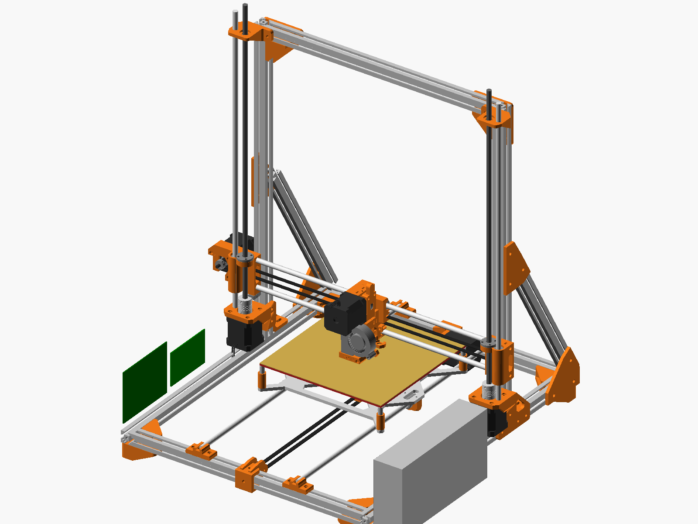

# 3D Printer from Scratch

A Prusa i3 type printer built from parts that I already own: original **Prusa i3 MK2** printed parts on a **2020 aluminium frame**, controlled by **Klipper** on a Raspberry Pi 3B+ with an MKS Gen L v1.0 board.

## Status

| Area | Status |
|---|---|
| CAD model and assembly guide | Done (19 steps) |
| Printed parts | Ordered (PETG, orange, 0.2 mm, 40 % infill) |
| Bought parts | Bill of materials complete, ordering |
| Assembly | Not started |
| Klipper configuration | Not started |

## Main data

| Item | Value |
|---|---|
| Frame | 8 × 2020 aluminium bars (590 mm stock), 8 cast corner brackets, M4 screws + drop-in T-nuts |
| Motion | 8 mm rods, LM8UU, GT2 belt with 20T pulleys (X, Y), 2 × T8 lead screw (Z, one motor each) |
| Motors | 5 × NEMA17 SM42STH48-1004A (1.0 A) on DRV8825 drivers |
| Bed | MK2 heatbed 214 × 214 mm, 12 V (≈ 1.1 Ω), switched by a separate MOSFET module |
| Hotend / extruder | E3D V6 clone, MK2 direct-drive extruder with MK8 drive gear |
| Electronics | MKS Gen L v1.0 (Klipper MCU), Raspberry Pi 3B+ (Klipper host), 12 V 15 A PSU |
| Materials | PLA and PETG only |
| Build volume | approx. 200 × 200 × 200 mm |

## Repository layout

| Folder | Content |
|---|---|
| [`assembly_guide/`](assembly_guide/index.html) | Step-by-step assembly guide (HTML + exploded views). Generated by `cad/guide/make_guide.py`. |
| [`cad/`](cad/README.md) | OpenSCAD model. `assembly_mk2.scad` is the current printer; `assembly_steps.scad` makes the guide pictures; `parts/` holds our own printed parts; `lib/vitamins.scad` the bought parts. |
| [`docs/`](docs/) | `Prusa_i3_build_list.xlsx`: parts to print, parts to purchase (grouped by vendor, with links), owned parts, cost summary. |
| [`print_files/`](print_files/README.txt) | Print list (`PRINT_LIST.csv`) and the STL files of our own parts. |

## Not in this repository

These folders exist only on my disk and are listed in `.gitignore`:

| Folder | Why |
|---|---|
| `third_party/` | GrabCAD downloads. The MK2-on-2020 meshes come from another author's GrabCAD model, and its licence is not known. |
| `misc/` | Quotations, vendor documents and photos. |
| `not_needed/` | Old files, kept for reference. |

For the same reason, the STL files of the **MK2 printed parts** (X-ends, X carriage, extruder, Z-bottoms, Z tops, Y holders) are not included. Only our own parts are published: bed spacer, brace gussets, endstop holder and the 4-screw Y motor mount.

**To render `cad/assembly_mk2.scad`**, you need the GrabCAD model *"Prusa i3 MK2 2020 aluminum profile"*. Convert its STEP file with `cad/mk2/step_tree.py` and put the result in `third_party/grabcad_files/prusa-i3-mk2-2020_stl/`. The original Prusa i3 MK2 parts are by Prusa Research (GPL v3).

## Licence

Our own files (OpenSCAD sources, scripts, guide, documents): MIT, see [LICENSE](LICENSE).
